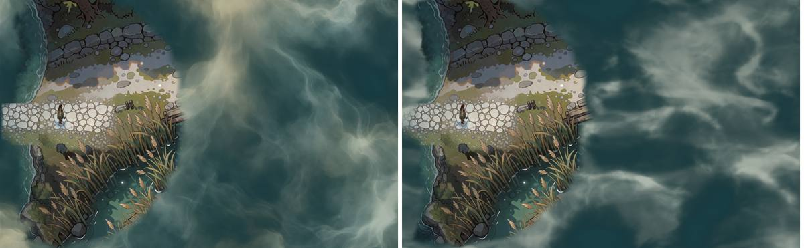
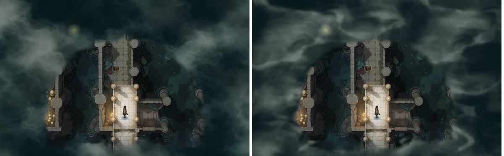
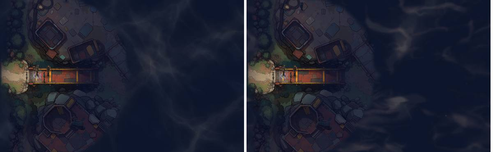
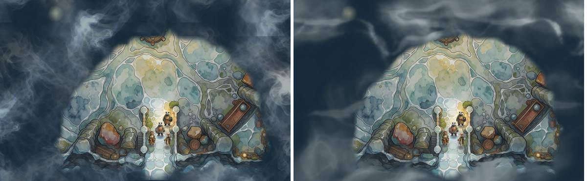
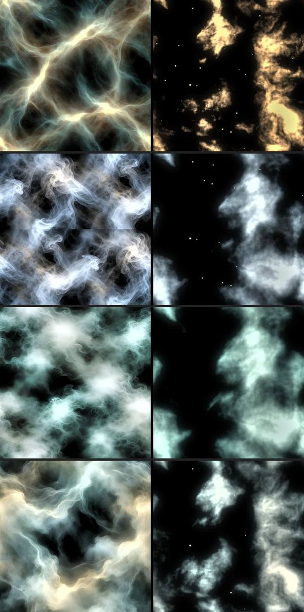

# Procedural mist against painted mist (28 October 2026)

> **Kept as a record.** This is the write-up of a finished study. Its scripts (under `packages/server/src/cli/_exp/`), its data and most of the pictures it names were removed for the 1.0 release and are in
> git history at the tag `pre-1.0-experiments`, as are the other studies it cites that are no longer in
> `docs/experiments/` or `docs/baselines/`. Paths that begin with `<study data>` or `<tools>` were on the author's own
> machine and are in neither.

Every place has a mist tile: a 1024 px square texture that tiles, which the client draws in WebGL as two drifting
layers over the ground past the painting's edge and as fog of war over unexplored ground (`render/mist.ts`; its
brightness is read as density). Until now Luna wrote a prompt, Krea 2 painted the tile, AnyPaint repainted the seams
to make it tile, and the tile was flattened. That cost about 9 GPU minutes a build, and once maps and art move to
Klein (see `docs/experiments/flux3-klein/`) it would be the only step that still needs Krea.

This experiment replaces the painting with noise, made on the CPU in about 3.5 seconds a place. It is now the build's
mist step (`worldgen/mistnoise.ts`, `makeMist` in `worldgen/atmosphere.ts`; how it works is in `docs/world-art.md`,
"Air and light").

## How it was compared

Four places from three built worlds, chosen for different kinds of air, using their saved drafts (no world was
rebuilt). Luna designed each place's procedural mist from the same brief the painted one had (four calls, well under
one cent). The game ran from this worktree against a scratch copy of the worlds, and each pair below is the same
frame of the game with only the tile swapped, captured from the game canvas at 1600 × 1000 and shown here reduced.
The painted tile is on the left, the procedural one on the right. Game time ran on during the session, so Cinderwake
is shown at night.

| Place | Air (Luna's words for the procedural mist) |
|---|---|
| The Saltglass Causeway (The Warm Below) | soft coastal sea mist drifting over brackish pools and reeds |
| The Drowned Abbey of Orra (The Warm Below, indoors) | cold sea mist pooling over the flooded cloister |
| Cinderwake (The Last Light of Vesper) | fine rust dust and metallic ash haze |
| Frostglass Grotto (The Lantern of Thimblebrook, indoors) | cold ice mist |

## What it showed

- **Soft fogs are as good.** At the Causeway, the Abbey and the Grotto the procedural mist reads as rolling sea or
  cave mist, fills the fog of war with the same weight as the painted one, breaks the fog's edge into wisps and
  drifts the same way in the game (the client's drift and parallax are unchanged). It is calmer and less detailed
  than the painted mist, which keeps the eye on the painting.
- **Hazes are close.** The painted Cinderwake mist is a dark field with soft glowing veins of dust. The first
  procedural versions had a brushed, fur-like grain and bright patches; with wisps drawn as veins (below) it is now
  a dim haze with a few long soft veins too. The painted veins are still finer and more fibrous.
- **The Causeway and the Abbey gained from the veins as well:** flowing, streaked fog rather than plain clouds.
- **The painted tiles have failures of their own.** Frostglass Grotto's painted tile shows its seam repair as a
  straight horizontal line in the game (top left of its picture). Noise tiles by construction and never has a seam.
- **The bright patch beside the party at Cinderwake is the party's light, not the tile.** The renderer cuts a
  radial hole of light out of a dark place's gloom around each party member, and it reaches past the explored
  circle onto the fog. The painted mist shows it too, more faintly.

What it took to get here, in order: a plain domain-warped noise looked like marbled liquid; a tile that was mostly
black showed in the game as bare fog, since the painted tiles' brightness is spread evenly (median about 0.55), so
the density is now spread by rank; strands drawn as level lines looked like water caustics or wood grain; streaks
now come from line integral convolution (fine noise smeared along a swirling flow) inside wisps drawn by a slow
noise; banks stretched along the drift so the fog flows; colours half greyed because the client tints the mist with
the place's light as well; and the tile is made at 512 px and enlarged, which looks the same in the game (the mist
is drawn at half the view's resolution) and takes a quarter of the time.

Then, for smoke and dust haze, the wisps became veins, which took four more lessons. Level lines of round noise close
into loops and outline blobs, so the vein noise is stretched along the drift, on a coarser lattice than the banks so
there are few of them. A vein drawn as "noise near zero" swells into a fat blob wherever the noise lingers near zero,
so a vein's width is its distance from the zero line in pixels (the noise divided by its slope), with the slope
floored so a vein has no dark holes where the noise flattens. Spreading the density evenly lifted the dim haze
between sparse veins into bright patches, so wispy air keeps part of its own brightness: bright veins over a dim
haze. And the broad veins are curled by the broad warp, not the finer one, which had folded them into zigzags. The first try is kept for reference:
painted tiles on the left, the first noise tiles on the right.

## Recommendation

Use the procedural mist. It saves about 9 GPU minutes a build, removes the mist's need for Krea, never shows a seam,
and is as good for fogs, mists, steam and indoor air, and close for smoke and dust haze. If the haze ever needs the
painted look, a small library of painted mist tiles (the four worlds already hold about 26), each greyed and
recoloured per place and chosen by Luna, would give it at no GPU cost per build.

## Reproducing

`packages/server/src/cli/_exp/mist/`: `compare.ts` designs the procedural mist of chosen places (Luna, capped at
$0.25) and writes its tile beside the painted one in a scratch copy of the worlds (`DAYDREAM_DATA_DIR`), as asset
`mistp_<zoneId>`; `tiles.ts` remakes tiles from saved designs without Luna; `halfsize.ts` compares a tile made at
full size with one made at half size. In the game, an administrator's browser console can switch a place's tile with
`__gd.state.zone.look.mist = '<asset key>'` once the asset is in `__gd.state.world.assets`.
